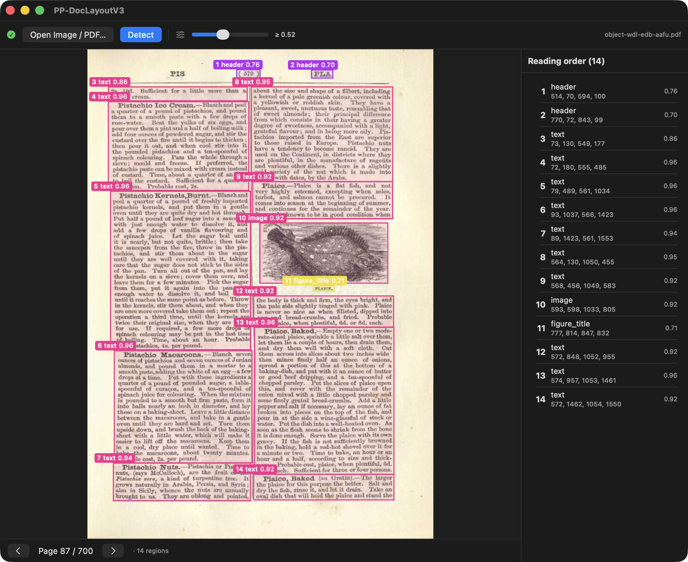

# mlx-swift-PPDocLayoutV3

MLX-Swift port of **[PP-DocLayoutV3](https://huggingface.co/PaddlePaddle/PP-DocLayoutV3_safetensors)**
— PaddlePaddle's document-layout detector — running on Apple Silicon via
[mlx-swift](https://github.com/ml-explore/mlx-swift).

📖 [API documentation](https://mnmly.github.io/mlx-swift-PPDocLayoutV3/) (DocC)



<sub>Document shown: *The Encyclopædia of Practical Cookery* (Warburg Institute /
World Digital Library) — <https://wdl.warburg.sas.ac.uk/object-wdl-edb-aafu>.</sub>

PP-DocLayoutV3 is an **RT-DETR** detector (HGNetV2-L backbone + hybrid AIFI/FPN/PAN
encoder + multi-scale deformable decoder) extended with a **mask-feature head**
(mask-enhanced reference points + per-query masks → polygons) and a **reading-order
global pointer**. ~33M params, fixed 800×800 input, single forward pass.

## Source of truth

Ported 1:1 from the official `transformers` (5.12.x) PyTorch reference
`transformers/models/pp_doclayout_v3/` (copies under `reference/python/`), with the
HGNetV2-L backbone from `transformers/models/hgnet_v2/`. Weights:
`PaddlePaddle/PP-DocLayoutV3_safetensors` (PyTorch NCHW, transposed to MLX NHWC at load).

## Usage

```swift
import MLXPPDocLayoutV3

// modelDir contains config.json + model.safetensors (e.g. the HF snapshot dir)
let pipeline = try PPDocLayoutV3Pipeline(modelDirectory: modelDir)
let detections = try pipeline.detect(imageURL: url, threshold: 0.5)

for (i, d) in detections.enumerated() {
    print("Order \(i+1): \(pipeline.label(d.label)) \(d.score) \(d.box)")
    // d.polygon: [(Float, Float)] mask-derived polygon points
    // d.orderRank: reading-order rank
}
```

Detections are returned **sorted by predicted reading order**, each with score,
class label, xyxy box (original-image pixels), reading-order rank, and a mask polygon.

## Architecture map (1 Python module → 1 Swift file)

| Stage | Swift |
|---|---|
| HGNetV2-L backbone | `Backbone/HGNetV2.swift` |
| Hybrid encoder (AIFI + FPN/PAN + mask head) | `Encoder/HybridEncoder.swift` |
| Multi-scale deformable attention (grid_sample Metal kernel) | `Decoder/MSDeformableAttention.swift`, `Decoder/GridSampleKernel.swift` |
| Deformable decoder + mask/order/class heads | `Decoder/Decoder.swift` |
| Model trunk (anchors, top-k, mask-enhanced refs) | `Model.swift` |
| Shared blocks (ConvNorm, FrozenBatchNorm, MLP) | `Common.swift`, `Attention.swift` |
| Pre/post-processing + polygons | `Processor.swift`, `PostProcess.swift`, `Polygon.swift` |
| Pipeline API | `Pipeline.swift` |

## Parity

Validated against the `transformers` oracle (`reference/dump_fixtures.py`):

- **Backbone**: fp32-exact (maxAbs ~1e-5).
- **Detections**: all 13 demo-image detections match — labels exact, scores ≤5e-3,
  boxes ≤2px (in ~2300px space). Reading order identical.

> The intermediate **encoder** feature maps drift ~0.1–0.2 maxAbs. This is **inherent
> fp32 GPU-vs-CPU convolution accumulation-order divergence** (the conv weights load
> bit-exact, yet a single 3×3 conv on large-magnitude activations differs ~0.7 at the
> padded corner). It does not affect final detections — the same behaviour is documented
> in the sibling `mlx-swift-PaddleOCR` layout port. **Gate parity on detections, not
> intermediate tensors.**

Polygon extraction reimplements cv2 `findContours`/`approxPolyDP` in pure Swift
(connected-components → Moore boundary trace → Douglas–Peucker + sharp-vertex pass).
Polygons are located correctly but **not bit-identical** to OpenCV.

## Benchmark (Apple Silicon, Release)

| | per image | speedup |
|---|---|---|
| MLX-swift (this) | **0.032 s** | — |
| PyTorch CPU reference | 0.464 s | **~14.5×** |

Active memory is **flat at 231 MB** across 30 in-process iterations (no leak); the
~1.5 GB cache is MLX's reusable buffer pool. Peak footprint 891 MB.

## Demo app

`Examples/PPDocLayoutV3Demo/` is a sandboxed SwiftUI macOS app: it checks
`~/.cache/huggingface` for the weights (with a **Download** button + folder picker
that persists a security-scoped bookmark), imports images **and PDFs** (per-page
navigation), and overlays detected boxes / labels / reading-order / polygons with a
live confidence slider. All compute goes through the library's `PPDocLayoutV3Pipeline`
(wrapped in an actor); the package + app build clean under Swift 6 strict concurrency.

## Documentation

DocC is wired via `swift-docc-plugin`; `Scripts/build_docs.sh` emits a Pages-ready
site and `.github/workflows/docs.yml` deploys it. Enable Pages once with
`gh api -X POST repos/mnmly/mlx-swift-PPDocLayoutV3/pages -f build_type=workflow`.

## Build / test

```bash
# Tests (detection-level parity + backbone) — needs the HF weights in ~/.cache/huggingface
xcodebuild -scheme mlx-swift-PPDocLayoutV3-Package -destination 'platform=macOS' test

# CLI harness
xcodebuild -scheme PPDocLayoutBench -configuration Release -destination 'platform=macOS' -derivedDataPath .xcdd-rel build
.xcdd-rel/Build/Products/Release/PPDocLayoutBench detect    # decode demo fixture
.xcdd-rel/Build/Products/Release/PPDocLayoutBench pipeline  # end-to-end from image file
.xcdd-rel/Build/Products/Release/PPDocLayoutBench bench 30  # timing + memory watch
```

> Use `xcodebuild`, not `swift build`/`swift test` — the latter can't load mlx-swift's
> Metal library.

## License

Apache-2.0. Model weights © PaddlePaddle.
